<p align="center">
  <picture>
    <source media="(prefers-color-scheme: dark)" srcset="brand/accountkit-logo-dark.svg">
    
  </picture>
</p>

# AccountKit

**AccountKit is a TypeScript SDK for House of Stake's Top Level Accounts (TLAs) on NEAR: NFTs that are also real NEAR accounts. Clubhouse is a members-only app built on it, where your membership is one of these accounts.**

Built at NEAR HACKATHON, 1–14 Nov 2026. Tracks: **`nfts`** (primary) and **`security`**.

| | |
|---|---|
| Demo video and X post | https://x.com/EmmanuelAje7/status/2121127745035895180 (1:42: the loophole, a real Meteor wallet on testnet, transactions on NearBlocks, a hijacked agent) |
| Repository | https://github.com/Nailer/accountkit |
| Network | NEAR **testnet** for every write. Mainnet is used read-only. No real money is involved. |
| License | MIT |

---

## For judges: the 5-minute check

Each command below prints a result you can compare. Everything runs on NEAR testnet or reads mainnet. Requirements: Node 20.12+ and pnpm 10.

```bash
pnpm install
pnpm --filter @accountkit/sdk build
```

| # | Run | You should see | What it proves |
|---|---|---|---|
| 1 | `pnpm test` | SDK `79 passed`, `4 skipped`; API `26 passed` | Verification, sign-in, transfer and grant rules, RPC failover and the API's security checks, offline |
| 2 | `pnpm test:live` | `ibuiltthisshit.bid VERIFIED owner: dizzy123.near` and 13 `ok` lines | The SDK reads House of Stake's **live mainnet** contracts correctly |
| 3 | `pnpm demo:bootstrap`, then `pnpm demo:status` | 3 new testnet accounts, a membership rented and `13/13 checks`; then `ready` | You get your own demo accounts. No keys from us are needed. |
| 4 | `pnpm e2e:transfer` | 10 `PASS` lines and a NearBlocks link | Access follows the NFT: the new owner gets in and the old owner is refused |
| 5 | `pnpm e2e:agent` | 8–9 `PASS` lines, `all checks passed` | An agent's budget is enforced on chain: overspending and unapproved receivers are refused |
| 6 | `pnpm e2e:attack` | 11–12 `PASS` lines, `all checks passed` | A hijacked agent can't escape its limits, and selling the NFT mid-payout ends the agent's access |
| 7 | `pnpm dev`, then open http://localhost:5173/demo#live | A live run streaming each step with transaction links | The same journey in the browser |

Details for each step are in [Try it](#try-it). Sample output from a fresh copy of this repository is in [Proof on chain](#proof-on-chain).

---

## Contents

1. [The problem](#the-problem)
2. [What a House of Stake account is](#what-a-house-of-stake-account-is)
3. [What AccountKit adds](#what-accountkit-adds)
4. [Use cases](#use-cases)
5. [How it works](#how-it-works)
   - [System overview](#51-system-overview)
   - [Reading and verifying a name](#52-reading-and-verifying-a-name)
   - [Signing in with an account that has no keys](#53-signing-in-with-an-account-that-has-no-keys)
   - [The members gate](#54-the-members-gate)
   - [Handing the account over](#55-handing-the-account-over)
   - [Threat model: how a seller might try to keep access](#56-threat-model-how-a-seller-might-try-to-keep-access)
   - [Agent budgets](#57-agent-budgets)
   - [Renting a name](#58-renting-a-name)
   - [Who signs what](#59-who-signs-what)
6. [Try it](#try-it)
7. [Proof on chain](#proof-on-chain)
8. [SDK reference](#sdk-reference)
9. [What is real, what is not](#what-is-real-what-is-not)
10. [Security notes](#security-notes)
11. [Limitations and next steps](#limitations-and-next-steps)
12. [Repository layout](#repository-layout)
13. [Built with](#built-with)
14. [Tracks](#tracks)
15. [Brand assets](#brand-assets)

---

## The problem

House of Stake runs the Top Level Accounts contracts on NEAR mainnet. They rent out names such as `alice.bid` (79 names were leased on `registry.hos` as of 12 Nov 2026). The contracts are live and audited. The hackathon's own NFT track prompt says:

> *"There's no SDK yet — you build on the contracts directly."*

Building on them directly means an app must understand six contract surfaces:
- the registrar;
- the registry, an NEP-171 NFT;
- the wallet code each account runs;
- the lease;
- the NEP-641 sign-in resolver;
- the spend grants.

It also has to get the security checks right on its own. A mistake here is costly. For example, the registry accepts a transfer to an account that doesn't exist yet, which hands the name to whoever creates that account first (we hit this ourselves; see [DEPLOYMENT.md](DEPLOYMENT.md)).

**AccountKit is that missing SDK.** It turns those surfaces into a few typed calls with the safety checks built in. **Clubhouse** shows the result in a working app.

AccountKit uses House of Stake's contracts as they are. It is not a wallet, a new account protocol or a replacement for nearaccounts.com.

---

## What a House of Stake account is

A leased name is three things at once:

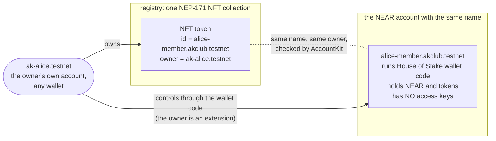

- **It is an NFT.** It sits in the registry like any NEP-171 token, so wallets and marketplaces understand it.
- **It is an account.** It can hold money, receive payments and call contracts.
- **It has no keys of its own.** It runs House of Stake's wallet code, which obeys whoever owns the NFT. Nobody holds a seed phrase for it.

**So owning the NFT means controlling the account.** Transfer the NFT and control of the account goes with it: its name, its permissions and its future income. The old owner's control ends in the same transaction.

House of Stake's wallet also **sends the account's spare NEAR back to the seller** during the transfer (`sweep_to`, `hos-wallet/src/lib.rs:1080`). The buyer receives the account with only its storage reserve, so a sale never hands over money the seller forgot to withdraw.

On most chains an account *is* a key, and you can't safely hand one over. On NEAR, named accounts and contract-run wallets make this possible.

---

## What AccountKit adds

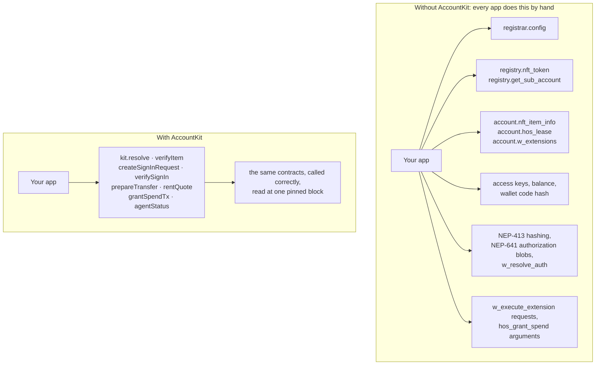

| You want to | Without AccountKit | With AccountKit |
|---|---|---|
| Know who owns a name, and that it is genuine | About 9 RPC reads across 3 contracts, then compare the results yourself | `verifyItem(await kit.resolve(name))`: 13 named checks |
| Let the owner sign in | Build an NEP-413 message, Borsh-hash it, build the NEP-641 authorization blob, call `w_resolve_auth`, follow its pending sub-authorizations, check the signer | `createSignInRequest`, then `buildAuthorization`, then `verifySignIn` |
| Transfer safely | `nft_transfer`, and remember to check the receiver exists | `kit.prepareTransfer(name, from, to)` refuses receivers that don't exist |
| Give an agent a budget | Hand-build `w_execute_extension` and `hos_grant_spend` arguments in the wallet's request format | `addExtensionTx`, `grantSpendTx`, `revokeSpendTx`, `kit.agentStatus` |

AccountKit **never holds keys**. Every state change comes back as a transaction for the user's own wallet to sign.

---

## Use cases

The question in each case is the same: *"what if an account could change hands as easily as an NFT, and the right people lost access when it did?"*

| Use case | Who uses it | How AccountKit is used | Status in this repo |
|---|---|---|---|
| **Membership clubs and gated communities.** Membership is an account; only the current holder gets in. | Clubs, DAOs, communities, paid groups | `verifySignIn` at login, plus `kit.resolve` and `verifyItem` on every members-only request | **Demonstrated** (Clubhouse) |
| **Transferable access passes.** Sell or gift a pass, and the seller is locked out automatically. | Event organisers, course platforms, SaaS seats | `prepareTransfer`, and the gate that re-reads the owner each time | **Demonstrated** (transfer and lock-out) |
| **Agent budgets.** Let a bot or AI agent pay bills from an account, capped and limited to named receivers. | Teams running agents, automated payouts | `addExtensionTx`, `grantSpendTx`, `revokeSpendTx`, `agentStatus` | **Demonstrated** with a scripted agent |
| **Sellable business accounts.** A shop, storefront or creator account whose name, payment address and future income go to the buyer. The seller automatically gets the spare NEAR back. | Marketplaces, small online businesses | `resolve` to show the owner, lease and status; `prepareTransfer` for the handover | Possible with the SDK today; no marketplace UI here |
| **Credentials and roles.** A role such as treasurer or moderator is an account; whoever holds it acts in that role. | DAOs, organisations | Sign-in and the gate as in Clubhouse, checked per role | Possible with the SDK today |
| **Name verification in wallets and explorers.** Show "this name is a genuine House of Stake account, owned by X, lease active". | Wallets, explorers, marketplaces | `kit.resolve` and `verifyItem` (13 checks) | Possible today; `pnpm test:live` shows it on mainnet |
| **Renting names in-app.** Let users get a name under your namespace without leaving your app. | Communities with their own TLA namespace | `kit.rentQuote` returns price, availability and the rent transaction | **Demonstrated** (Clubhouse "Rent with my wallet", and `demo:bootstrap`) |

---

## How it works

### 5.1 System overview

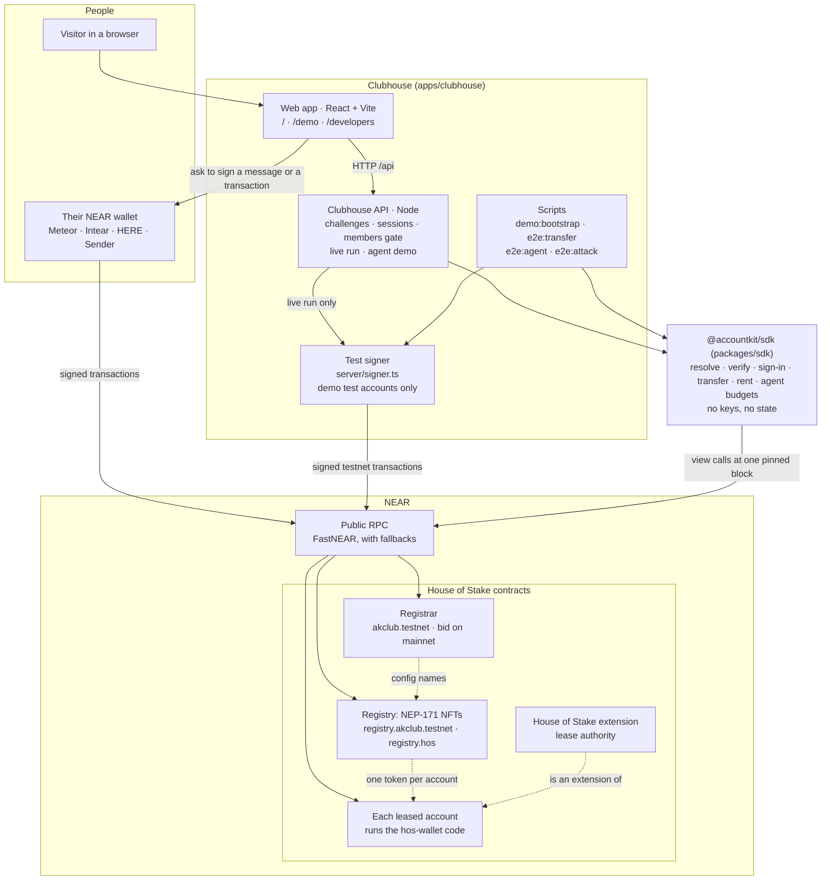

| Part | What it does | Holds keys? |
|---|---|---|
| `@accountkit/sdk` | Reads and verifies names, builds sign-in requests and checks them, and builds every transaction | No |
| Clubhouse web app | The pages people see: home, the demo (live run, wallet, lookup) and developer docs | No. Users sign in their own wallet. |
| Clubhouse API | Issues one-time sign-in challenges, verifies sign-ins, re-checks ownership on every members-only request, streams the live run | Only for the **test accounts** of the live run, read from a local key folder, never from the repository |
| Scripts | Create demo accounts and prove each journey on testnet | Same test accounts |
| House of Stake contracts | Own the names, enforce ownership, sign-in resolution and spend grants | Not ours. We deployed an unmodified copy to testnet. |

### 5.2 Reading and verifying a name

`kit.resolve(name)` reads everything about a name **at one pinned block**, so the answers can't disagree because of timing. `verifyItem` then runs 13 checks on what it read.

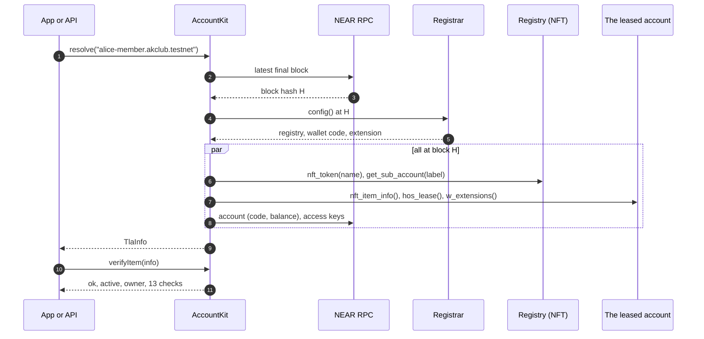

| # | Check | What it rules out |
|---|---|---|
| 1 | `registry-has-token` | A name the registry doesn't know |
| 2 | `item-spec` | An account that isn't a House of Stake item (`sharded-item-1.0.0`) |
| 3 | `item-names-collection` | An account claiming a different collection than the registrar's |
| 4 | `item-names-itself` | An item pointing at some other account |
| 5 | `owners-agree` | The registry and the account disagreeing about the owner |
| 6 | `runs-registrar-wallet` | An account running wallet code other than the registrar's |
| 7 | `authority-is-hos-extension` | A lease authority other than House of Stake's extension |
| 8 | `owner-is-extension` | An owner who can't actually control the account |
| 9 | `no-access-keys` | **Anyone holding a key to the account**, a back door around the NFT |
| 10 | `item-active` | A frozen or retired item |
| 11 | `lease-active` | A lease that isn't active |
| 12 | `not-frozen` | A frozen lease |
| 13 | `lease-not-expired` | An expired rental |

Checks 1–9 decide whether the record is genuine (`ok`); checks 10–13 decide whether it is usable right now (`active`).

### 5.3 Signing in with an account that has no keys

The membership account has no keys, so it can't sign anything itself. NEP-641 solves this: the account's wallet code answers `w_resolve_auth` and says "my owner speaks for me". The owner signs an NEP-413 message in their normal wallet. This is not a transaction and costs no gas.

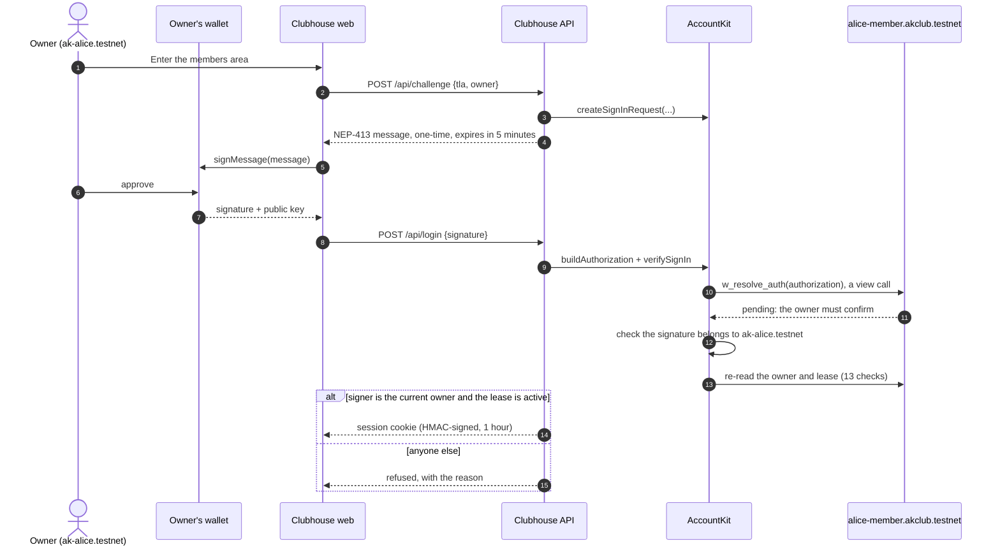

`verifySignIn` accepts only when all of these hold (`packages/sdk/src/auth.ts`):
- the signed payload is exactly the one the server issued;
- the signer is the **current verified owner**;
- the lease is active.

The server's challenge can be used once and expires after 5 minutes.

### 5.4 The members gate

A session cookie only says who signed in. **Whether they still own the membership is read from the chain on every members-only request** (`currentMember` in `apps/clubhouse/server/index.ts`). That is what locks a seller out the moment the NFT moves, even if their cookie is still valid.

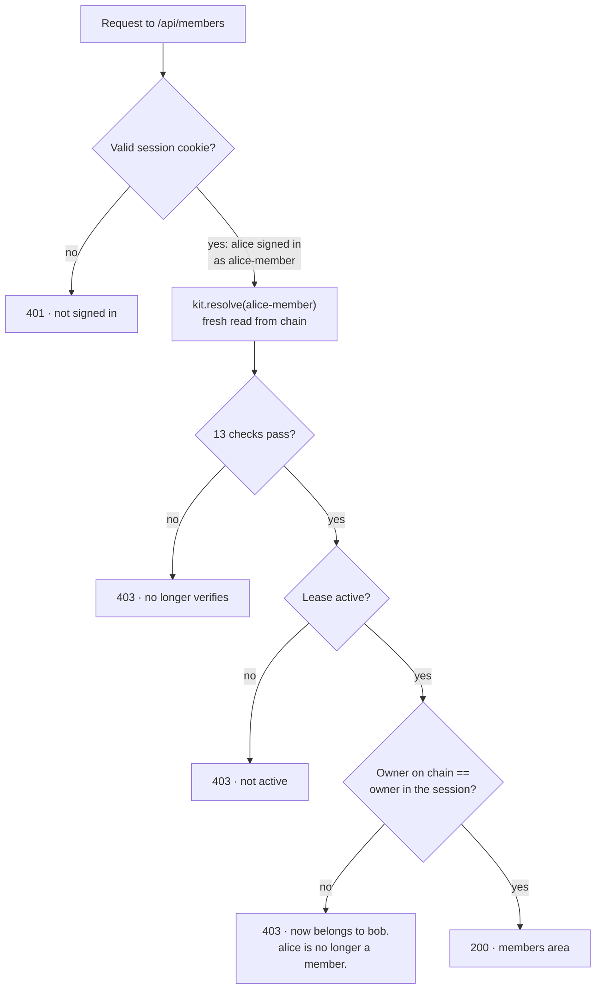

### 5.5 Handing the account over

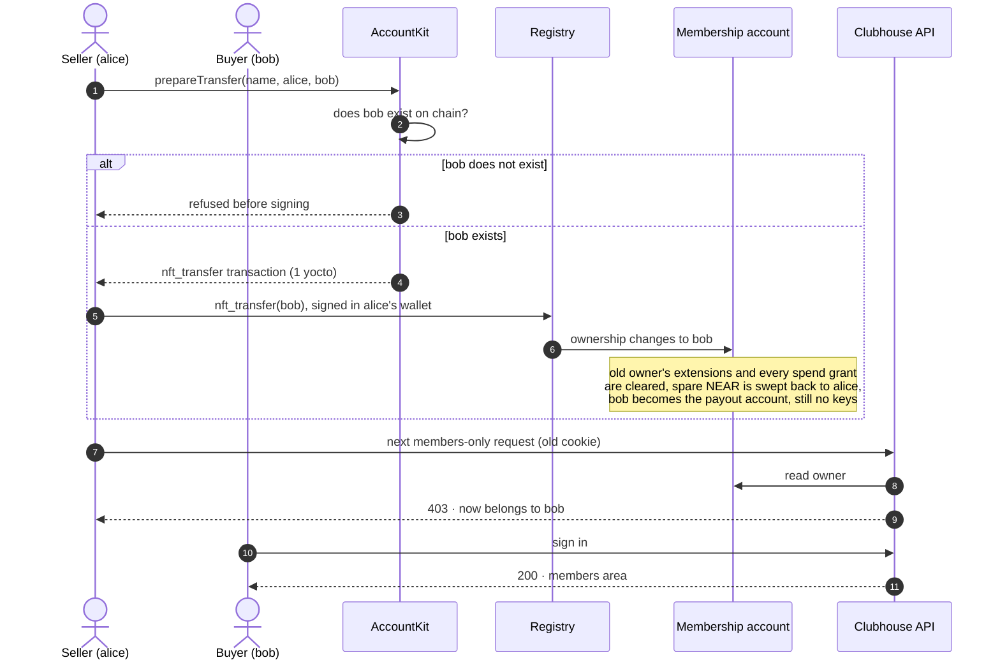

Who controls the account, before and after:

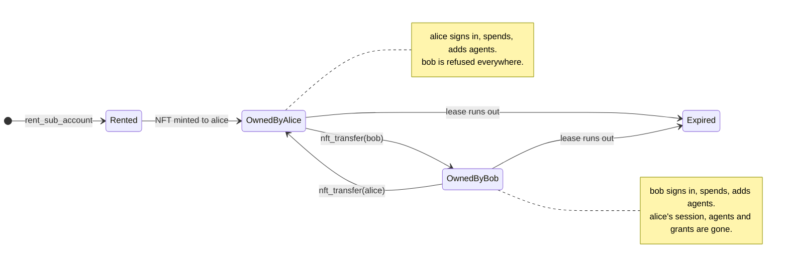

### 5.6 Threat model: how a seller might try to keep access

The NFT track asks teams to explain exactly how control passes on transfer and what stops the old owner from keeping access. Here is every route we know of, what stops it, where it is enforced, and how it is proven.

| # | The seller tries to… | What stops it | Enforced by | Proven by |
|---|---|---|---|---|
| 1 | Keep a private key to the account | The account has no access keys. AccountKit refuses to verify any account that has one (check 9). | House of Stake wallet code; AccountKit check | `e2e:transfer` "the account still holds no keys"; `test:live` on mainnet |
| 2 | Keep signing in after the sale | `w_resolve_auth` only delegates to the current owner, and `verifySignIn` re-reads the owner | Wallet contract; AccountKit | `e2e:transfer` "old owner is refused" |
| 3 | Reuse a session cookie from before the sale | The gate re-reads the chain on every request | Clubhouse API | `e2e:server` "same session cookie is refused" |
| 4 | Leave an agent or co-owner behind to keep spending | A transfer clears the old owner's extensions and all spend grants (`hos-wallet/src/lib.rs:786`) | Wallet contract | `e2e:transfer` "no extension of the old owner survives"; `e2e:attack` step 7 |
| 5 | Keep an agent paying during the sale ("sale in the middle of a payout") | The next payment after the transfer is refused: the grant is gone | Wallet contract | `e2e:attack` steps 5–7 |
| 6 | Have their agent sign in as the membership | A spend-grant holder can't act as owner (`lib.rs:468`, "grantee not owner") | Wallet contract | `e2e:attack` step 4 |
| 7 | Have an agent add an accomplice or remove the new owner | Only the current owner can add or remove extensions (`lib.rs:1111–1117`) | Wallet contract | `e2e:attack` steps 2–3 |
| 8 | Transfer to an account that doesn't exist, then create it themselves | `prepareTransfer` refuses receivers that don't exist (the registry would accept them) | AccountKit | `e2e:transfer` "transfer to a non-existent account is refused before signing" |
| 9 | Undo the sale afterwards | No path exists for the seller. The only "revert" in the contracts is NEP-171's standard give-back, which the **receiving contract** triggers inside the same `nft_transfer_call` transaction (`tla-registry/src/nft.rs:301–330`). | Registry | Contract source |

Money, for clarity: the account's spare NEAR is **not** something a seller can lose or a buyer can expect. House of Stake's wallet sweeps it to the seller's payout account during the transfer and makes the buyer the new payout account (`hos-wallet/src/lib.rs:786–817`). `e2e:attack` checks this: the account went from 0.610 to 0.010 test NEAR at the sale, and the seller received it. We have only tested NEAR. The wallet code doesn't sweep fungible tokens on transfer, and we haven't tested token balances.

### 5.7 Agent budgets

The owner can let another account act for the membership account, such as a bot or an AI agent, with limits **stored and enforced by the account's own wallet contract**:
- a budget;
- an expiry time;
- a list of receivers it may pay.

AccountKit builds the transactions and reads the state back.

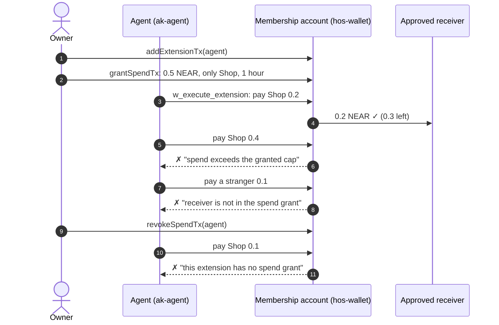

What a compromised agent **cannot** do (all tested by `pnpm e2e:attack` on testnet):

| Attempt | Result |
|---|---|
| Pay any account not in the grant, including its own | Refused: receiver not in the spend grant |
| Spend more than the budget, or after expiry | Refused: spend exceeds the granted cap, or the grant has expired |
| Add an accomplice, or remove the owner | Refused: only the owner edits extensions |
| Sign in as the membership account | Refused: a grantee is not the owner |
| Keep spending after the NFT is sold | Refused: the sale cleared its grant and its extension |
| Touch the NFT itself | Not possible: the NFT is held by the owner's own account, which the agent has no access to |

**Why the agent doesn't use a function-call key.** The security track suggests function-call access keys. They can't be used here, and the reason is worth knowing:
- House of Stake's wallet refuses any extension call that carries no deposit (`hos-wallet/src/lib.rs:252`).
- [NEAR function-call keys](https://docs.near.org/protocol/accounts-contracts/access-keys) cannot attach a deposit.

So the agent's own account needs a full-access key. The containment comes from the grant instead: the money sits in the membership account, behind the contract's limits. The agent's own account only holds gas money.

If the agent's key leaked, the worst case is that the remaining budget gets paid to receivers the owner already approved, before the grant expires. The owner can revoke the grant at any time.

The agent in this demo is **scripted, not AI**: each task is a fixed payment. A real model could be plugged in, and the limits would hold the same way, because the contract decides, not the agent.

### 5.8 Renting a name

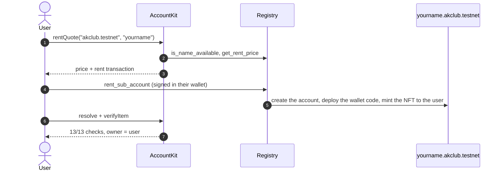

Prices come from the registry and depend on name length. A 16-character name cost 1.591 test NEAR on 12 Nov 2026; names of 12+ characters cost about 1.6–1.7.

### 5.9 Who signs what

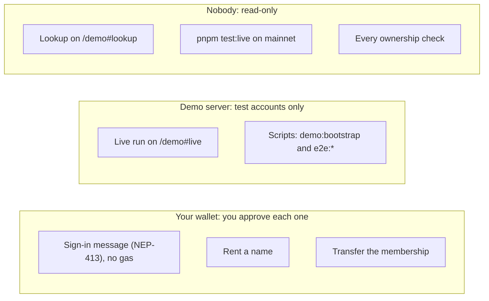

The demo server signs only for test accounts whose keys sit in a local folder (`~/.near-credentials`, or the git-ignored `apps/clubhouse/.demo-keys/` that `demo:bootstrap` writes). Clubhouse never asks anyone for a seed phrase or private key.

---

## Try it

Requirements: **Node 20.12+** and **pnpm 10**. Everything runs on NEAR testnet or reads mainnet; nothing spends real money.

```bash
pnpm install
pnpm --filter @accountkit/sdk build
```

### 1. Unit tests (offline)

```bash
pnpm test
```

→ **SDK: 79 passed, 4 skipped. API: 26 passed.** The skipped ones are the live tests, which need `LIVE=1`.
- The SDK tests cover Borsh and NEP-641 hashing (including the standard's own example), sign-in requests and round trips, each of the 13 checks failing on its own, `prepareTransfer` and its nine refusals, spend-grant validation, renting, NEAR amounts, and RPC failover with a mocked network.
- The API tests cover session cookies (forgery, expiry, malformed input), the cross-site check, request bodies and rate limiting.

`pnpm lint` runs Biome. `pnpm --filter @accountkit/sdk test:coverage` reports coverage.

### 2. Verify a real mainnet name (read-only, about 10 seconds)

```bash
pnpm test:live
```

→ `ibuiltthisshit.bid VERIFIED owner: dizzy123.near`, then 13 `ok` lines read from House of Stake's live mainnet contracts. To check another name: `pnpm --filter @accountkit/sdk example:resolve <name>`.

### 3. Create your own demo accounts (testnet, about 1 minute)

```bash
pnpm demo:bootstrap
```

→ The script:
1. Creates three new testnet accounts from the public faucet: two members and an agent, 10 test NEAR each.
2. Has the first member rent a membership with the SDK's `rentQuote()` transaction.
3. Prints `13/13 checks`.
4. Writes the account names to `apps/clubhouse/.env`.

Keys go to `apps/clubhouse/.demo-keys/`, which git ignores, and are never printed. If the faucet answers with a rate-limit error, wait a few minutes and run it again. Or set `FUNDER=<your testnet account>` to pay for the accounts from an account whose key is in `~/.near-credentials`.

### 4. The ownership journey (testnet)

```bash
pnpm e2e:transfer
```

→ 10 `PASS` lines:
1. The membership verifies.
2. The owner signs in.
3. The other member is refused.
4. A transfer to an account that doesn't exist is refused before signing.
5. `nft_transfer` succeeds, with a NearBlocks link.
6. The registry and the account agree on the new owner.
7. The account still has no keys.
8. No extension of the old owner survives.
9. The new owner signs in.
10. The old owner is refused.

Run it again to move the membership back.

### 5. Agent limits (testnet)

```bash
pnpm e2e:agent
```

→ `all checks passed`, with 9 `PASS` lines (8 if the agent was already enabled). The owner grants 0.5 test NEAR for one receiver. 0.2 is allowed; 0.4 more and a payment to an unapproved account are refused on chain. After the revoke, every payment is refused.

### 6. A hijacked agent, and a sale in the middle of a payout (testnet)

```bash
pnpm e2e:attack
```

→ `all checks passed`, with 12 `PASS` lines (11 if the agent was already enabled); the full log is in [Proof on chain](#proof-on-chain).
- The agent tries to pay itself, add an accomplice, remove the owner and sign in as the membership. All four are refused.
- Then it makes one approved payment, the owner sells the NFT, and the agent's next payment is refused.
- The account's spare NEAR goes back to the seller.

### 7. Clubhouse in the browser

```bash
cp -n apps/clubhouse/.env.example apps/clubhouse/.env   # skip if demo:bootstrap already wrote it
pnpm dev
```

Open http://localhost:5173.

| Page | Do this | You should see |
|---|---|---|
| `/` | Look at the pass at the top, then scroll to "What runs for real, and what doesn't" | The membership's owner, "13/13 passed" and "Access keys: None", read live from testnet |
| `/demo#live` | Choose **Ownership journey** and press **Start the live run** | Steps stream in, each with a NearBlocks link: the stranger is turned away, the membership is transferred, and the old owner is refused. **Agent limits** runs the budget check. This needs step 3 first; without it the page says "The live run isn't available on this server". |
| `/demo#lookup` | Enter `alice-member.akclub.testnet`, or the name `demo:bootstrap` printed, and press **Check this account** | "Record verified", "13/13 on-chain checks passed" and the current owner. `wrap.testnet` gives "Not a House of Stake account"; a misspelt name gives "No account with that name". |
| `/demo#wallet` | Connect a testnet account in Meteor, Intear, HERE or Sender (the faucet gives free test NEAR) | Your memberships under `akclub.testnet` are listed |
| | Type a name of 12+ characters under "Rent a name in the club" and press **Rent with my wallet** | The name appears in your list, for about 1.7 test NEAR |
| | Press **Enter the members area** and approve the message in your wallet | "Welcome in", with the membership's checks. No transaction, no gas. |
| | Under "Hand over your membership", enter another testnet account you control, then press **Transfer** and **Yes, transfer it** | "Access refused", with a link to the transfer. Connect the receiving account and sign in: it gets in. |
| `/developers` | Read | Each function, the contract method it calls, and the error codes |

`pnpm e2e:server` runs the gate through the HTTP API while `pnpm dev` is running: after the transfer, the **same session cookie** is refused.

---

## Proof on chain

### From a fresh copy of this repository (12 Nov 2026)

We copied the repository into an empty folder, with no `.env` and no keys, and ran the steps above. Every write is a public testnet transaction.

| Step | Result | Transaction |
|---|---|---|
| `demo:bootstrap`: three accounts from the faucet, 10 test NEAR each | `akd-b41c3c-a`, `-b`, `-agent` `.testnet` | — |
| `demo:bootstrap`: rent `akdb41c3c-member.akclub.testnet` with `rentQuote()` (1.591 test NEAR) | 13/13 checks, owner `akd-b41c3c-a.testnet` | [fPWXAHRX…](https://testnet.nearblocks.io/txns/fPWXAHRXZu94CTYdeLTrtYV6DfJaTDfj8jJvTrwo1d1) |
| `e2e:transfer`: `nft_transfer` a → b | 10/10 checks passed | [4Hgzh96Q…](https://testnet.nearblocks.io/txns/4Hgzh96QYY9bduFVHVEVUC6ydakrprgXbNEJ7dXFaD9Q) |
| `e2e:agent`: 0.2 allowed, 0.4 refused, unapproved receiver refused, refused after revoke | 9/9 checks passed | links printed by the script |
| `e2e:attack` 1: agent pays itself | refused: "receiver is not in the spend grant" | [5NfmZMQg…](https://testnet.nearblocks.io/txns/5NfmZMQgqLUi5ePGuFybCY3DNXEX6LKbs7sULxENPK7D) |
| `e2e:attack` 2: agent adds an accomplice | refused: "only the owner may perform this operation" | [GQKLbJXe…](https://testnet.nearblocks.io/txns/GQKLbJXebXwuh8jLMWWsQfJDK4KE6wdLUFXDek61P1yW) |
| `e2e:attack` 3: agent removes the owner | refused: "only the owner may perform this operation" | [BboxK85E…](https://testnet.nearblocks.io/txns/BboxK85Ea9iAZmTjbdsND4qCDHn6JyxyTjKp5Ay43AC4) |
| `e2e:attack` 4: agent signs in as the membership | refused: "a spend grantee cannot authorise as an owner" | view call, no transaction |
| `e2e:attack` 5: approved 0.2 payment | allowed | [2AmsvjVe…](https://testnet.nearblocks.io/txns/2AmsvjVeeCaENJB8EKGwSpDjgvGUSnZrm2dt1ntpTcMd) |
| `e2e:attack` 6: owner sells mid-payout | ownership moved; spare NEAR swept back to the seller | [A8QmDhpa…](https://testnet.nearblocks.io/txns/A8QmDhpaYdSv7dztW77vQtS8p4Dr4SYzjmoNPcJzeWVz) |
| `e2e:attack` 7: agent's next payment | refused: "extension … is not enabled" | [84qj1nU4…](https://testnet.nearblocks.io/txns/84qj1nU4PQyjbxFMLn5cqVxaU5BKErc8URddBaewzx2r) |

The `e2e:attack` log as printed (`pnpm e2e:attack`):

```text
membership akdb41c3c-member.akclub.testnet
owner akd-b41c3c-a.testnet · agent akd-b41c3c-agent.testnet · approved receiver akd-b41c3c-b.testnet · buyer akd-b41c3c-b.testnet
PASS  setup: owner enabled the agent
PASS  setup: owner grants the agent 0.5 NEAR, only to akd-b41c3c-b.testnet, for 1 hour
— the agent is compromised and tries to escape its limits —
PASS  1. agent tries to pay 0.3 NEAR to its own account
      refused on chain: "receiver is not in the spend grant"
PASS  2. agent tries to add akclub.testnet as another agent
      refused on chain: "only the owner may perform this operation"
PASS  3. agent tries to remove the owner and lock them out
      refused on chain: "only the owner may perform this operation"
PASS  4. agent tries to sign in to Clubhouse as the membership
      refused: …w_resolve_auth: a spend grantee cannot authorise as an owner
PASS     after the attempts: owner still in control, budget untouched
      grant spent: 0 yocto
— a payout is running when the owner sells the membership —
PASS  5. agent pays the approved 0.2 NEAR to akd-b41c3c-b.testnet
PASS  6. owner sells: nft_transfer akd-b41c3c-a.testnet -> akd-b41c3c-b.testnet
PASS  7. agent tries the next approved payment after the sale
      refused on chain: "extension 'akd-b41c3c-agent.testnet' is not enabled"
PASS     akd-b41c3c-b.testnet now controls the account; the seller's agent and grant are gone
      owner akd-b41c3c-b.testnet · w_extensions = [akd-b41c3c-b.testnet, ext.akclub.testnet] · access keys: 0
PASS     the account's spare NEAR went back to the seller, not to the buyer
      membership balance 0.810 -> 0.610 after the payout -> 0.010 after the sale (storage reserve); seller +0.598
all checks passed: the agent could not escape its budget, and the sale ended its access
```

(Transaction links are trimmed from this copy; the script prints them in full. In this run the approved receiver and the buyer happen to be the same account, because `demo:bootstrap` makes the second member the approved receiver.)

### From a real browser wallet (13 Nov 2026)

The wallet journey in Clubhouse (`/demo#wallet`), driven with a Meteor wallet on testnet (`itup.testnet`). This is the flow shown in the demo video.

| Step | Result | Transaction |
|---|---|---|
| Connect Meteor | Connected as `itup.testnet` (no transaction) | |
| Rent `itup-clubpass.akclub.testnet` | `rent_sub_account`, 1.69105 test NEAR, Success; NFT minted for `itup.testnet` | [ziTQ5HBS…](https://testnet.nearblocks.io/txns/ziTQ5HBSU1pK63akqjypURXFobPXun2JYiJbNLjFi67) |
| Enter the members area | Signed message (NEP-413), no transaction, no gas; 13/13 checks | |
| Transfer to `ak-ghost-7f3.testnet` (doesn't exist) | Refused by `prepareTransfer` before the wallet opened; nothing signed | |
| Transfer to `ak-alice.testnet` | `nft_transfer`, Success; `itup.testnet` refused on its next visit | [3XNY4jTA…](https://testnet.nearblocks.io/txns/3XNY4jTAGmBir35ZDA9Qh5cB9e5fV4pFQaegibqAcdoD) |

This run found two bugs, both fixed: wallet-selector 10 rejected AccountKit's action format ("Unsupported NAJ action"), and the refused-transfer message appeared out of view.

### From the original deployment

Our deployment of House of Stake's contracts, with the first journeys we ran, is listed in [DEPLOYMENT.md](DEPLOYMENT.md). Every row links to NearBlocks:
- the first rent;
- the `rentQuote()` rent;
- transfers in both directions;
- the agent's allowed payment and both refused payments.

---

## SDK reference

```ts
import { AccountKit, verifyItem, createSignInRequest, buildAuthorization, verifySignIn } from "@accountkit/sdk";

// Read and verify any House of Stake name (mainnet or testnet).
const kit = new AccountKit({ network: "mainnet" });
const info = await kit.resolve("ibuiltthisshit.bid");
const { ok, active, owner, checks } = verifyItem(info); // true, true, "dizzy123.near", 13 checks

// Server side: issue a sign-in request; the owner's wallet signs req.nep413.
const req = createSignInRequest({ tla: info.name, owner, chainId: kit.chainId, payload });
// ...the wallet returns { publicKey, signature }...
const result = await verifySignIn(kit, {
  tla: info.name,
  authorization: buildAuthorization(req, signed),
  expectedPayload: req.payload,
});
if (result.ok) {
  /* signed in as the current owner */
}

// Build a safe transfer for the owner's wallet (refuses receivers that don't exist).
const tx = await kit.prepareTransfer(info.name, owner, "bob.near");
```

| Function | What it gives an app | Contract methods behind it |
|---|---|---|
| `kit.resolve(name)` | Everything about a name, read at one pinned block | registrar `config`; registry `nft_token`, `get_sub_account`; account `nft_item_info`, `hos_lease`, `w_extensions`, keys, balance |
| `verifyItem(info)` | 13 named checks, `ok`, `active`, `owner` | follows House of Stake's draft "sharded NFT items" rule |
| `createSignInRequest`, `buildAuthorization`, `verifySignIn` | Sign in as a name with no transaction (NEP-413 + NEP-641) | `w_resolve_auth` (view) |
| `kit.prepareTransfer(name, from, to)` | The NEP-171 transfer for the owner's wallet; refuses receivers that don't exist | registry `nft_transfer` (1 yocto) |
| `kit.rentQuote(tla, label)` | Price, availability and the rent transaction | `is_name_available`, `get_rent_price`, `rent_sub_account` |
| `kit.namesOwnedBy(owner)` | Names an account owns | `nft_tokens_for_owner` |
| `addExtensionTx`, `removeExtensionTx` | Add or remove an agent or co-owner | `w_execute_extension` |
| `grantSpendTx`, `revokeSpendTx`, `kit.agentStatus`, `kit.spendGrant` | Give, end and read an agent's budget | `hos_grant_spend`, `hos_revoke_spend`, `hos_agent_status`, `hos_spend_grant` |
| `executeTx` | Have an extension send NEAR, tokens or a call from the account | `w_execute_extension` |

Errors carry codes you can branch on: `INVALID_NAME`, `NOT_FOUND`, `NOT_A_TLA`, `LEASE_EXPIRED`, `WRONG_OWNER`, `RPC_UNAVAILABLE`, `CONTRACT_PANIC`, `AUTH_INVALID`.

The SDK depends only on `@noble/curves`, `@noble/hashes` and `@scure/base`. It works in browsers and Node. It is a workspace package here and isn't published to npm yet.

---

## What is real, what is not

| Part | Status |
|---|---|
| Mainnet read and verify | **Real.** Live House of Stake contracts, view calls only. |
| Testnet contracts | **Real House of Stake code, our deployment.** Unmodified contracts at `d85860a`, deployed with House of Stake's own scripts. The `akclub.testnet` namespace exists because we are the council of our own copy; on mainnet only House of Stake's council can do this. We also extended the price staleness window to 30 days ([DEPLOYMENT.md](DEPLOYMENT.md)). |
| Sign-in | **Real.** NEP-641 resolution against the account's own `w_resolve_auth`. Signatures come from the wallet (browser) or from near-api-js (scripts). |
| Transfers, rents, agent payments and refusals | **Real testnet transactions**, with links. |
| Live run in the browser | **Real testnet transactions, signed by the demo server** for test accounts whose keys it holds locally. `demo:bootstrap` creates those for you. |
| Agent | **Scripted, not AI.** Each task is a fixed payment. The enforcement is real: the refusals come from the wallet contract, with its own error messages. |
| Browser wallet flow | Built and compiled. At the time of writing, no person has yet clicked through it end to end; the same steps are covered by the scripts. |
| History view per membership | **Linked, not built.** Each membership card links to its account history on NearBlocks; there is no indexer of our own. |
| Mainnet writes | Out of scope. This project never writes to mainnet. |

---

## Security notes

- **No keys in the repository.** Test keys live in `~/.near-credentials` or the git-ignored `apps/clubhouse/.demo-keys/`, and are never printed.
- **The API listens on 127.0.0.1 by default** (`HOST` changes it) and **refuses cross-site POSTs** (`ALLOWED_ORIGINS` adds trusted origins). A web page on another site can't make it sign or log anyone in.
- **Sign-in challenges are single-use** and expire after 5 minutes. Sessions are HMAC-signed cookies (`HttpOnly`, `SameSite=Lax`) that last 1 hour. Ownership is re-read on every members-only request, whatever the cookie says.
- **Transfers to accounts that don't exist are refused** before anything is signed.
- **Rate limits:** 30 sign-in requests a minute and 6 live runs per 10 minutes per IP. Outstanding challenges are capped at 5,000.
- **Every response** carries `nosniff`, `DENY` framing and `no-referrer` headers. Malformed or oversized bodies get 400 or 413, never a 500.
- **The live run is for demos.** It signs with test accounts, stops after 3 minutes if RPC hangs, and real users always sign in their own wallet.

All settings are listed in [`apps/clubhouse/.env.example`](apps/clubhouse/.env.example). `GET /api/health` reports RPC reachability and whether the demo keys are present. See [SECURITY.md](SECURITY.md) for the full policy.

---

## Limitations and next steps

- **Wallet path:** built, but not yet exercised by a person (see above).
- **No history view of our own** per membership: it would need an indexer. Each membership links to its history on NearBlocks instead.
- **Not on npm yet.** For now, use it from this workspace.
- **Testnet namespace:** creating a mainnet namespace needs House of Stake's council. AccountKit already reads mainnet names, and its write paths are the same contract calls.
- **Renting on our testnet copy works until about 11 Dec 2026.** The price feed's staleness window was extended to 30 days ([DEPLOYMENT.md](DEPLOYMENT.md)).

---

## Repository layout

```
packages/sdk          @accountkit/sdk: TypeScript, ESM, no dependencies beyond @noble/* and @scure/base
  src/kit.ts          resolve, verify, transfer, rent, names, agent status
  src/auth.ts         NEP-413 and NEP-641 sign-in
  src/verify.ts       the 13 checks
  src/actions.ts      transaction builders (transfer, rent, extensions, spend grants)
  src/names.ts        account-id and name parsing
  src/units.ts        parseNear / formatNear
  src/rpc.ts          JSON-RPC client with endpoint failover
  test/               unit tests, plus live tests gated by LIVE=1
  examples/           resolve and transfer dry-run (read-only)
apps/clubhouse        the demo app
  src/                React + Vite web app (pages, demo tabs, wallet connection)
  server/             Node API: challenges, sessions, the members gate, the live run, the agent
  server/test/        API unit tests
  scripts/            demo:bootstrap, demo:status and the e2e scripts
brand/                logo, icon and banner (SVG and PNG)
vendor/               House of Stake's tla-contracts (not committed; clone at d85860a to rebuild)
DEPLOYMENT.md         our testnet deployment, settings and transaction evidence
FEASIBILITY.md        what we checked before building, and why testnet
SECURITY.md           security policy and what each property relies on
CHANGELOG.md          what changed, by version
```

---

## Built with

- **AI assistance (disclosed per rule Q-005):** most of the code and documentation was written with Claude Code (Anthropic), directed and reviewed by the team.
- **Contracts:** House of Stake [`tla-contracts`](https://github.com/houseofstake/tla-contracts) @ `d85860a`, unmodified.
- **Standards:** [NEP-171](https://github.com/near/NEPs/blob/master/neps/nep-0171.md) (NFTs), [NEP-413](https://github.com/near/NEPs/blob/master/neps/nep-0413.md) (signed messages), [NEP-641](https://github.com/near/NEPs/blob/master/neps/nep-0641.md) (account-level authorization, Final v1.0.0).
- **SDK dependencies:** `@noble/curves` 2.0.1, `@noble/hashes` 2.0.1, `@scure/base` 2.0.0.
- **App:** React 19.2, Vite 7.1, `motion` 14.6, `lenis` 1.3, NEAR Wallet Selector 10.1.4 (Meteor, Intear, HERE and Sender modules), `near-api-js` 6.5.1 (browser) and 7.3.1 (server-side test signing).
- **Tooling:** TypeScript 5.9, Vitest (with V8 coverage), Biome, tsx, concurrently, pnpm, GitHub Actions.
- **Network:** public NEAR RPC (FastNEAR, with fallbacks) and the NEAR testnet faucet.

All code in this repository was written during the hackathon window (first commit 11 Nov 2026).

---

## Tracks

- **`nfts`, NFTs That Do Something (primary).** Top Level Accounts are NFTs that are accounts: they hold money and carry membership and access rights. AccountKit is the SDK the track prompt says is missing. Clubhouse gates a page on current ownership, and the [threat model](#56-threat-model-how-a-seller-might-try-to-keep-access) explains exactly how control passes on transfer and what stops the old owner keeping access. Tests cover the transfer path, including a sale in the middle of a payout.
- **`security`, AI Security & Defense.** An agent gets money without the keys to everything. Its budget, expiry and approved receivers are enforced by the account's contract. `e2e:attack` shows a hijacked agent being stopped on chain, with the log. We explain above why a function-call key can't be used here, and what contains the agent instead.

We don't claim `agents`, `defi`, `social`, `games` or `open`.

---

## Brand assets

The logo is an account (rounded square) bound to a token (circle): the NFT and the account are one thing. The text is converted to outlines, so the files look the same everywhere.

| File | Use |
|---|---|
| [`brand/accountkit-logo-light.svg`](brand/accountkit-logo-light.svg) / [`.png`](brand/accountkit-logo-light.png) | Logo on light backgrounds |
| [`brand/accountkit-logo-dark.svg`](brand/accountkit-logo-dark.svg) / [`.png`](brand/accountkit-logo-dark.png) | Logo on dark backgrounds |
| [`brand/accountkit-mark.svg`](brand/accountkit-mark.svg) / [`-512.png`](brand/accountkit-mark-512.png) | The mark alone, as an app icon or favicon |
| [`brand/accountkit-square-1024.png`](brand/accountkit-square-1024.png) | Square avatar |
| [`brand/accountkit-banner-1200x630.png`](brand/accountkit-banner-1200x630.png) (and a `2400x1260` version) | Submission, social posts and link previews |

The app uses `apps/clubhouse/public/favicon.svg`, `favicon.ico`, `apple-touch-icon.png` and `og-image.png`. Colours: ink `#0F0E0B`, NEAR green `#00EC97`, paper `#F3EFE6`. Typeface: Bricolage Grotesque.

---

## License

MIT. See [LICENSE](LICENSE).
